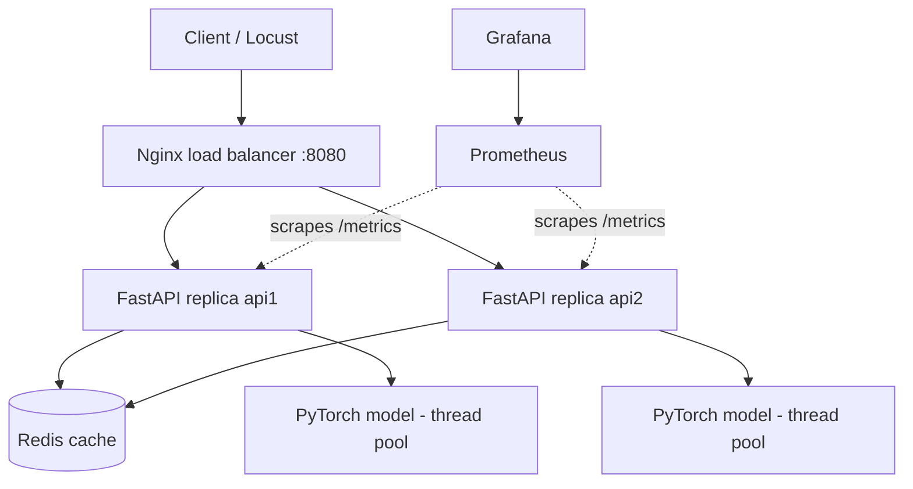

# Distributed AI Model Serving & Inference Platform

A small, runnable **ML inference service** that shows how the pieces around a model fit together:
a FastAPI REST API serving a PyTorch model, a shared Redis prediction cache, two API replicas behind an
Nginx load balancer, Prometheus + Grafana monitoring, Locust load tests, a benchmark report generator,
and Kubernetes manifests for a local cluster.

> **Be honest about what this is.** It is a *learning/portfolio* project for local machines. It is **not**
> production-grade infrastructure: no authentication, no TLS, single non-replicated Redis, no autoscaling,
> no secrets management, no rate limiting. See [Limitations](#limitations-and-future-improvements).
> The model is a tiny MLP trained on **synthetic data** to exercise the serving stack; it makes **no claim of
> real-world predictive accuracy**.

## Verification status (read this first)

This repository was generated in an environment **without Docker, Redis, PyTorch or network access**, so the
author could only run static checks (Python syntax compile, YAML/JSON parsing, and the pure-Python benchmark
math/CSV-parsing helpers). **Nothing else has been executed by the author**, and **no benchmark numbers exist yet**.
Run the commands below on your machine and fill in the checklist honestly:

| Check | How | Status |
|---|---|---|
| Unit tests pass | `pytest` | ⬜ not yet run by you |
| Model trains / app starts | `python -m model.train` then `uvicorn app.main:app` | ⬜ |
| Compose stack healthy | `docker compose up -d --build` then `docker compose ps` | ⬜ |
| Integration tests pass | `pytest -m integration` | ⬜ |
| Grafana dashboard loads data | http://localhost:3000 | ⬜ |
| Benchmark run recorded | `python scripts/benchmark.py ...` | ⬜ |

If something fails, see [Troubleshooting](#troubleshooting); the code was written carefully but unrun code can contain bugs.

## Table of contents
1. [Architecture](#architecture) · 2. [Tech stack](#technology-stack) · 3. [Features](#features) · 4. [Prerequisites](#prerequisites)
5. [Local setup (Windows)](#local-development-setup-windows-powershell) · 6. [Configuration](#environment-variables) · 7. [API](#api-endpoints)
8. [Docker Compose](#docker-compose) · 9. [Monitoring](#monitoring-prometheus--grafana) · 10. [Testing](#testing) · 11. [Load testing](#load-testing-with-locust)
12. [Benchmark methodology](#benchmark-methodology) · 13. [Results](#results) · 14. [Interpreting results](#interpreting-results) · 15. [Kubernetes](#kubernetes)
16. [Concepts](#key-concepts-explained) · 17. [Troubleshooting](#troubleshooting) · 18. [Limitations](#limitations-and-future-improvements) · 19. [GitHub](#publishing-to-github)

## Architecture



```
Client / Load generator
        |
        v
  Nginx (round-robin)  :8080
     |            |
     v            v
  api1          api2          <- same Docker image => same trained model artifact
     \            /
      +----------+----> Redis (shared cache; key = namespace:model_version:sha256(features))
      |
      +----> PyTorch MLP (loaded once at startup, run in a thread pool)

  Prometheus --scrapes--> api1:8000/metrics, api2:8000/metrics  --> Grafana dashboard
```

### Request lifecycle (`POST /predict`)
1. The client sends JSON to Nginx, which picks a replica (round-robin) and adds an `X-Request-ID`.
2. Middleware reuses/generates the request id, starts a timer, and puts the id into the logging context.
3. Pydantic validates the body (finite numbers, 1–1024 values); the route checks the length equals the model's `input_dim`.
4. **Cache lookup:** the features are serialised canonically and hashed → key `infer:<model_version>:<sha256>`. A hit (with matching model version and input hash re-checked) returns immediately.
5. **Miss:** inference runs in a worker thread (`run_in_executor`) so the event loop keeps serving other requests; a timeout and a pending-request cap protect the service.
6. The prediction is stored in Redis with a TTL (best effort) and returned with metadata (`cached`, `instance`, `model_version`, `request_id`, latency). Header `X-Cache` is `HIT`, `MISS`, `BYPASS` or `UNAVAILABLE`.
7. Middleware records Prometheus metrics (labels use the *route template*, never raw URLs) and one JSON log line.

## Technology stack
Python 3.12 · FastAPI · Uvicorn · PyTorch (CPU) · Pydantic v2 / pydantic-settings · Redis (`redis-py` asyncio) · HTTPX ·
Docker & Compose · Nginx · Prometheus · Grafana · Locust · pytest (+ pytest-asyncio, fakeredis) · Kubernetes manifests (Kustomize).

Compatibility notes: dependencies are pinned in `requirements.txt` / `requirements-dev.txt`. `torch==2.5.1` supports Python 3.12;
use Python 3.12 (not 3.13) for this pin set. On Windows, PyPI's torch wheel is CPU-only; the Dockerfile installs the CPU wheel explicitly.
`pytest-asyncio` runs in `auto` mode (see `pytest.ini`).

## Features
- Validated REST API with request ids, structured JSON logs, safe error responses (no stack traces to clients).
- Reproducible synthetic training; model loaded **once** at startup, `eval()` + `torch.inference_mode()`.
- Redis cache: deterministic keys, TTL, version-safe, hit/miss/error metrics, configurable outage policy (`bypass` or `fail`) plus a tiny circuit breaker.
- Non-blocking inference via a thread pool, timeouts, overload protection (503).
- `/predict/baseline` for fair cache vs. no-cache comparisons.
- Compose stack: Nginx + 2 replicas + Redis + Prometheus + Grafana (auto-provisioned dashboard).
- Locust scenarios + `scripts/benchmark.py` that runs them and computes real improvement numbers.
- Unit tests (no Docker needed) and integration tests (need the stack).

## Prerequisites
- Windows 10/11 with PowerShell, **Python 3.12** (`py -3.12 --version`), Git.
- **Docker Desktop** (WSL2 backend) for Compose and optional Kubernetes.
- If PyTorch fails to import on Windows, install the *Microsoft Visual C++ Redistributable (x64)*.
- Optional: `kubectl` and a local cluster (Docker Desktop Kubernetes, kind, or minikube).

## Local development setup (Windows PowerShell)

```powershell
cd distributed-ai-inference
py -3.12 -m venv .venv
.\.venv\Scripts\Activate.ps1          # if blocked: Set-ExecutionPolicy -Scope Process -ExecutionPolicy Bypass
python -m pip install --upgrade pip
pip install -r requirements-dev.txt   # large download (PyTorch) - be patient
Copy-Item .env.example .env           # optional: edit values; .env is git-ignored

python -m model.train                 # creates model/artifacts/model.pt
```
Expected: `Saved model to model/artifacts/model.pt` and a synthetic validation accuracy line.

Run the unit tests (no Docker, no real Redis; uses fakeredis):
```powershell
pytest
```

Run the API locally. It needs a Redis; the easiest is Docker just for Redis:
```powershell
docker compose up -d redis
uvicorn app.main:app --reload --port 8000
```
Open http://localhost:8000/docs (interactive Swagger UI). No Docker? Disable the cache: `$env:CACHE_ENABLED="false"`, or just leave Redis
down — with the default `bypass` policy the API still answers (header `X-Cache: UNAVAILABLE`).

## Environment variables
All have defaults; see `.env.example`. In Compose they are passed to both replicas (`docker-compose.yml`), in Kubernetes via `k8s/configmap.yaml`.

| Variable | Default | Meaning |
|---|---|---|
| `MODEL_PATH` | `model/artifacts/model.pt` | Model artifact |
| `EXTRA_FORWARD_PASSES` | `0` | **Benchmark knob**: repeat the forward pass N extra times to emulate a heavier model. Always state it when publishing results. |
| `REDIS_URL` | `redis://localhost:6379/0` | Redis location |
| `REDIS_TIMEOUT_SECONDS` | `0.25` | Connect/read timeout for Redis calls |
| `REDIS_MAX_CONNECTIONS` | `64` | Redis connection pool size |
| `CACHE_ENABLED` | `true` | `false` makes `/predict` behave like the baseline |
| `CACHE_TTL_SECONDS` | `300` | Lifetime of cached predictions |
| `CACHE_NAMESPACE` | `infer` | Key prefix (benchmarks flush only this prefix) |
| `CACHE_FAILURE_POLICY` | `bypass` | `bypass`: serve uncached if Redis is down. `fail`: return 503 and report not-ready |
| `CACHE_RETRY_AFTER_SECONDS` | `5` | After a Redis failure, skip Redis this long (avoids a timeout on every request) |
| `INFERENCE_THREADS` | `2` | Worker threads running the model per process |
| `TORCH_NUM_THREADS` | `1` | PyTorch intra-op threads per inference |
| `INFERENCE_TIMEOUT_SECONDS` | `2.0` | Per-request inference timeout (→ 504) |
| `MAX_PENDING_INFERENCES` | `256` | In-flight inference cap (→ 503) |
| `UVICORN_WORKERS` | `1` | Uvicorn processes per container (see note below) |
| `GRAFANA_ADMIN_USER/PASSWORD` | `admin` / `admin` | Grafana login (change it in `.env`) |

## API endpoints

| Method & path | Purpose |
|---|---|
| `GET /health` | Liveness (process is up) |
| `GET /ready` | Readiness: model loaded; Redis checked (503 only if policy is `fail`) |
| `GET /model/info` | Model version, input dimension, classes, inference settings |
| `POST /predict` | Cache-enabled prediction |
| `POST /predict/baseline` | Same model/validation, **never** uses the cache |
| `GET /metrics` | Prometheus metrics (blocked at Nginx; use `localhost:8001/8002`) |

Request body: `{"features": [16 numbers]}`. Example (PowerShell, via the load balancer once Compose is up):

```powershell
Invoke-RestMethod http://localhost:8080/model/info

$body = Get-Content examples\predict_request.json -Raw
Invoke-RestMethod -Method Post -Uri http://localhost:8080/predict -ContentType "application/json" -Body $body

# See headers (X-Cache, X-Served-By, X-Request-ID) - run it twice and watch MISS -> HIT:
curl.exe -s -i -X POST http://localhost:8080/predict -H "Content-Type: application/json" --data-binary "@examples/predict_request.json"
```

Response shape (values are produced by *your* run - placeholders shown):
```json
{
  "request_id": "<32-char id>",
  "model_version": "1.0.0-<8-hex>",
  "prediction": {
    "class_index": "<0|1|2>",
    "label": "<class_a|class_b|class_c>",
    "probabilities": {"class_a": "<float>", "class_b": "<float>", "class_c": "<float>"}
  },
  "cached": "<false on first call, true on repeat>",
  "instance": "<api1|api2>",
  "server_latency_ms": "<float>"
}
```
Errors look like `{"error": "validation_error"|"invalid_input"|"inference_timeout"|"overloaded"|"cache_unavailable"|"internal_error", "detail": ..., "request_id": ...}`
with status 422 / 422 / 504 / 503 / 503 / 500.

Invalid input example (wrong length → 422):
```powershell
Invoke-RestMethod -Method Post -Uri http://localhost:8080/predict -ContentType "application/json" -Body '{"features":[1,2,3]}'
```

## Docker Compose

```powershell
docker compose up -d --build        # build image (trains the model inside it) and start everything
docker compose ps                   # expect api1, api2, redis, nginx "healthy"
docker compose logs -f api1 api2    # JSON logs; Ctrl+C to stop following
docker compose restart api1         # restart one service
docker compose stop                 # stop (keeps data volumes)
docker compose down                 # remove containers + network (keeps volumes)
docker compose down -v              # ALSO deletes Prometheus/Grafana data
```
Check both replicas answer through Nginx:
```powershell
1..10 | ForEach-Object { (Invoke-WebRequest -Method Post -Uri http://localhost:8080/predict/baseline -ContentType "application/json" -Body (Get-Content examples\predict_request.json -Raw)).Headers["X-Served-By"] }
```
You should see both `api1` and `api2`. (PowerShell 7 returns header values as arrays; that is fine.)

Ports (all bound to `127.0.0.1` only): Nginx `8080`, api1 `8001`, api2 `8002`, Redis `6379`, Prometheus `9090`, Grafana `3000`.

More replicas help *capacity* (more requests handled in parallel when CPU is available) but do not automatically reduce latency or raise throughput:
on a laptop all containers share the same cores, and Nginx/Docker networking add overhead.

**Workers, CPU and memory.** Every Uvicorn worker or replica is a separate process with its **own copy of PyTorch and the model (hundreds of MB of RAM each)**.
CPU use ≈ replicas × workers × `INFERENCE_THREADS` × `TORCH_NUM_THREADS` (at saturation). Keep that product ≤ your physical cores.
This repo defaults to `UVICORN_WORKERS=1` per container because Prometheus' default metrics registry is per-process; with several workers in one container,
`/metrics` would show only whichever worker answered. Scale with replicas instead (or add Prometheus multiprocess mode).

## Monitoring (Prometheus + Grafana)
- Prometheus: http://localhost:9090 → *Status → Targets*: `api1` and `api2` should be **UP**.
- Grafana: http://localhost:3000 (login from `GRAFANA_ADMIN_USER` / `GRAFANA_ADMIN_PASSWORD`, default `admin`/`admin`) → *Dashboards → Inference Platform → Inference Platform Overview*. The Prometheus data source and dashboard are provisioned automatically from `grafana/`.

Metrics exposed (all instrumented in `app/`): `http_requests_total{method,endpoint,status}`, `http_request_duration_seconds` (histogram),
`inference_duration_seconds` (histogram), `cache_hits_total`, `cache_misses_total`, `cache_errors_total{operation}`, `prediction_failures_total{reason}`, `model_info{model_version}`.

How to read the dashboard:
- **Latency p50/p95/p99** are estimated from histogram buckets (`histogram_quantile`), so precision is limited by bucket width. They are measured *inside the app* (exclude Nginx and client time), so they will be lower than Locust's numbers.
- **Cache hit ratio** = hits / (hits + misses); lookups that failed because Redis was down count as `cache_errors`, not misses.
- **Inference duration** only includes requests that actually ran the model (cache hits skip it).
- **Per-replica panels** use the `instance` label Prometheus adds per scrape target. Roughly equal lines mean round-robin is balancing.
- Panels show "No data" until traffic flows; that is normal. Generate traffic with the commands above or Locust.

## Testing

```powershell
pytest                       # unit + API tests (no Docker needed; Redis is faked)
pytest tests/unit/test_cache.py -v
docker compose up -d --build
pytest -m integration        # needs the running stack; skips itself if it is not reachable
```
Unit tests cover: schema validation, model loading/inference, cache keys/hit/miss/TTL expiry/version safety/corruption/outage/circuit breaker,
health/readiness (incl. degraded Redis), baseline vs. cached correctness, invalid payloads (incl. NaN and malformed JSON), metrics endpoint,
request ids, timeouts, overload, a check that the event loop is not blocked during inference, and concurrent requests.
Integration tests check: readiness via Nginx, cache hit on repeat, **cache shared across replicas**, both replicas serving traffic, `/metrics` blocked at Nginx but available per replica.

## Load testing with Locust

Terminology (these are different things!):
- **Users**: simulated clients. Each user is a loop: send request → wait for response → (optional think time) → repeat.
- **Total requests**: how many requests completed in the run (depends on speed and duration).
- **Concurrency**: requests in flight at the same instant. With closed-loop users it is **at most** the number of users, usually lower.

Interactive UI (http://localhost:8089):
```powershell
$env:SCENARIO = "warm"      # baseline | cold | warm | varied | baseline_varied
locust -f loadtests/locustfile.py --host http://localhost:8080
```
Headless, **500 users**, spawn 50 users/second, 60 seconds, CSV output:
```powershell
$env:SCENARIO = "baseline"
locust -f loadtests/locustfile.py --headless --host http://localhost:8080 -u 500 -r 50 -t 60s --csv results\manual_baseline --reset-stats
```
Limit by request count instead (approximate; in-flight requests finish): `$env:MAX_REQUESTS = "20000"`.
Other knobs: `HOT_KEYS` (size of the repeated-input set, default 20), `THINK_TIME_SECONDS`.

A single laptop running Locust, Docker, Nginx, two APIs and Redis may not sustain 500 users. Signs of trouble: errors/timeouts, Locust CPU near 100%,
or flat req/s as users increase. Then start with `-u 100`, increase to 250 and 500 while watching errors, and report the highest load that stayed healthy.
Locust itself is Python on one core; for very high rates run it distributed (`--master`/`--worker`) from another machine.

## Benchmark methodology

`scripts/benchmark.py` automates the comparison and writes `results/<timestamp>/{report.md,summary.json,summary.csv}` plus Locust's raw CSVs.

| Scenario | Endpoint | Inputs | Cache state at start |
|---|---|---|---|
| **A** Baseline | `/predict/baseline` | repeated (hot set, default 20 vectors) | n/a (no cache used) |
| **B** Cold cache | `/predict` | same hot set | flushed (only `CACHE_NAMESPACE` keys), **not** pre-filled |
| **C** Warm cache | `/predict` | same hot set | flushed, then **pre-filled** with exactly those vectors |
| **D** Varied | `/predict` | unique every request | flushed |
| **E** Baseline varied | `/predict/baseline` | unique every request | n/a — comparison partner for D |

Fairness rules built in: identical payload generator for all scenarios (`loadtests/payloads.py`); the same validation and model code path; connections/model are warmed
via `/predict/baseline` before every scenario (it never writes to Redis); Locust statistics are reset after ramp-up (`--reset-stats`) so the spawn phase is excluded;
cache hit ratio is read from server counters before/after each run. **B vs. C is not a like-for-like comparison — it shows exactly the cold/warm difference.**

```powershell
docker compose up -d --build
# 100 users, 30 s per scenario, all five scenarios:
python scripts/benchmark.py --users 100 --spawn-rate 25 --run-time 30
# 500 users (if your hardware allows), 60 s, only A and C:
python scripts/benchmark.py --users 500 --spawn-rate 50 --run-time 60 --scenarios A,C
# request-count limited runs:
python scripts/benchmark.py --users 100 --max-requests 20000 --run-time 120
```
Computed from the measurements (never hardcoded; the goals are only used to label the result "yes/no"):

- p95 latency reduction % = (baseline p95 − optimized p95) / baseline p95 × 100  — goal ≥ 30 % (A→C)
- throughput multiplier = optimized req/s ÷ baseline req/s  — goal ≥ 2× (A→C)

Run each benchmark several times and report the spread; close other heavy programs; record your CPU, RAM, Docker resource limits and `EXTRA_FORWARD_PASSES`.

## Results

**No measurements have been taken yet.** Fill in this table from your own `results/<timestamp>/report.md`. Do not publish numbers you did not measure.

| Scenario | Users | Req/s | Avg ms | p50 | p95 | p99 | Error % | Cache hit ratio |
|---|---|---|---|---|---|---|---|---|
| A Baseline | _tbd_ | _tbd_ | _tbd_ | _tbd_ | _tbd_ | _tbd_ | _tbd_ | n/a |
| B Cache, cold | _tbd_ | _tbd_ | _tbd_ | _tbd_ | _tbd_ | _tbd_ | _tbd_ | _tbd_ |
| C Cache, warm | _tbd_ | _tbd_ | _tbd_ | _tbd_ | _tbd_ | _tbd_ | _tbd_ | _tbd_ |
| D Cache, varied inputs | _tbd_ | _tbd_ | _tbd_ | _tbd_ | _tbd_ | _tbd_ | _tbd_ | _tbd_ |
| E Baseline, varied inputs | _tbd_ | _tbd_ | _tbd_ | _tbd_ | _tbd_ | _tbd_ | _tbd_ | n/a |

| Goal | Measured | Met? |
|---|---|---|
| ≥ 30 % p95 reduction (A→C) | _tbd_ | _tbd_ |
| ≥ 2× throughput (A→C) | _tbd_ | _tbd_ |

Test machine / settings: _CPU, RAM, Docker CPU/memory limits, replicas, `INFERENCE_THREADS`, `EXTRA_FORWARD_PASSES`, hot keys, date_ — _tbd_

## Interpreting results
Do not assume the cache wins. A cache hit costs: Nginx hop + API parsing/validation + **a Redis network round trip** + JSON decode. A miss costs all that **plus** inference **plus** a Redis write.
- **Model complexity.** This MLP has ~19k parameters and runs in well under a millisecond on CPU. When inference is about as fast as a Redis round trip, caching gives little or even *negative* benefit (see D vs. E). Caching shines when compute is expensive. To explore that honestly, raise `EXTRA_FORWARD_PASSES` (e.g. `$env:EXTRA_FORWARD_PASSES=200; docker compose up -d`) and **say so** when reporting.
- **Input repetition.** Benefit scales with the hit ratio. Unique inputs (D) can never hit; real traffic is somewhere between A/C and D.
- **Overhead.** Nginx, Docker Desktop's network layer, JSON (de)serialisation and FastAPI itself often dominate sub-millisecond compute.
- **CPU limits & load generator.** Locust, Docker, and the services share your cores. If Locust saturates a core, you are measuring Locust. Watch Task Manager and the Grafana dashboard.
- **Worker count.** More replicas/threads help only while free cores exist; beyond that they add contention and memory use.
- **If a goal is not met:** look at Prometheus `inference_duration_seconds` vs. client-side latency (where does time go?), check `cache_errors_total`, hit ratio, CPU saturation, and try `EXTRA_FORWARD_PASSES`, fewer/more `INFERENCE_THREADS`, or a longer run. Change one variable at a time.

## Kubernetes

Manifests in `k8s/`: Namespace, ConfigMap, Redis Deployment+Service (demo only), API Deployment (2 replicas, probes, CPU/memory requests+limits), API Service. `k8s/optional/ingress.yaml` is **not** applied by default and needs an Ingress controller you install yourself.

```powershell
docker build -t distributed-ai-inference:local .

# Make the local image available to your cluster:
#   Docker Desktop Kubernetes: nothing to do (shares the local Docker image store)
#   kind:      kind load docker-image distributed-ai-inference:local
#   minikube:  minikube image load distributed-ai-inference:local

kubectl apply -k k8s/ --dry-run=client       # validate (client-side)
kubectl apply -k k8s/                        # deploy
kubectl -n inference get pods,svc            # wait for READY 1/1
kubectl -n inference logs deploy/inference-api --tail=50
kubectl -n inference port-forward svc/inference-api 8081:80    # then http://localhost:8081/docs (leave running)
kubectl -n inference scale deploy/inference-api --replicas=4
kubectl delete -k k8s/                       # clean up
```
How traffic is spread: the `inference-api` Service has a stable virtual IP; `kube-proxy` forwards each **new TCP connection** to one of the *ready* pod endpoints
(readiness probes remove unhealthy pods). Long-lived keep-alive connections stick to one pod, so a few clients can look unbalanced; many clients average out.
`kubectl port-forward` talks to a single pod, so it does not demonstrate balancing — test from inside the cluster instead:
`kubectl -n inference run curl --rm -it --image=curlimages/curl --restart=Never -- sh -c 'for i in 1 2 3 4 5 6; do curl -s -D - -o /dev/null -X POST http://inference-api/predict/baseline -H "Content-Type: application/json" -d "{\"features\":[0,0,0,0,0,0,0,0,0,0,0,0,0,0,0,0]}" | grep -i x-served-by; done'`.

The Redis here is a single pod without persistence, replication or authentication: **local demonstration only**, not a highly available Redis architecture.
Prometheus/Grafana are not deployed in Kubernetes by this repo (the pod annotations only help if your cluster already runs annotation-based discovery).
The manifests were validated only as YAML syntax by the author; run `kubectl apply --dry-run=client` yourself.

## Key concepts explained
- **Async I/O vs. CPU-bound inference.** `await redis.get()` *waits* on the network, so the event loop can do other work meanwhile (async helps). Model inference *computes* on the CPU; `async def` does not make it faster and, if run inline, would freeze the loop. We run it in a thread pool; PyTorch releases the GIL in native kernels so threads can truly overlap.
- **Why a thread pool and not processes?** Simplest model that is correct: one loaded model per container, shared read-only by threads. Heavy CPU-bound workloads might prefer more processes/replicas or batching; this is documented as a future improvement, not needed for a tiny model.
- **Why caching helps repeated requests.** Identical input + same model version ⇒ identical output, so storing it avoids recomputation. It does not help unique inputs and adds a network hop (see above). Concurrent identical misses may all compute once each (no request coalescing).
- **Cache safety.** Key and stored value both contain the model version and the input hash; a mismatch is treated as a miss.
- **Liveness vs. readiness.** `/health` = "restart me if this fails"; `/ready` = "send me traffic only if this is OK".

## Troubleshooting
| Symptom | Fix |
|---|---|
| `Activate.ps1 cannot be loaded` | `Set-ExecutionPolicy -Scope Process -ExecutionPolicy Bypass` then activate again |
| `pip` can't find `torch==2.5.1` | You are probably on Python 3.13+. Use `py -3.12 -m venv .venv` |
| `OSError: [WinError 126] ... fbgemm.dll` | Install Microsoft Visual C++ Redistributable (x64), reopen the terminal |
| `FileNotFoundError: Model artifact not found` | Run `python -m model.train` (from the project root) |
| `ModuleNotFoundError: app` | Run commands from the project root (the folder with `app/`), venv active |
| API works but `X-Cache: UNAVAILABLE` | Redis is not reachable. `docker compose up -d redis`; check `REDIS_URL` |
| `docker compose` build is slow first time | PyTorch download; later builds are cached |
| Compose: port already in use | Stop the other program or change the host port in `docker-compose.yml` |
| Grafana panels "No data" | Check http://localhost:9090/targets are UP; send traffic; widen the time range |
| `/metrics` returns 404 on :8080 | Intentional — use `http://localhost:8001/metrics` or `:8002` |
| Locust errors / timeouts at 500 users | Lower `-u`; machine or Docker limits are the bottleneck — report it, don't hide it |
| Redis flush in benchmark fails | Redis port 6379 must be published (it is in the Compose file); check `--redis-url` |
| Pods `ErrImagePull` / `ImagePullBackOff` | Load the local image into the cluster (see Kubernetes section) |

## Limitations and future improvements
Not implemented (so this is **not** production-grade): authentication/authorisation, TLS, rate limiting, secrets management, Redis HA/auth/TLS,
autoscaling (HPA), request coalescing for concurrent identical misses, dynamic batching, GPU support, model registry/rollouts, distributed tracing,
Prometheus multiprocess mode for multi-worker containers, alerting rules, CI pipeline, and Kubernetes-native monitoring.
Ideas: add `locust` distributed workers, an HPA based on CPU, ONNX Runtime/TorchScript comparison, micro-batching, Redis Sentinel, GitHub Actions running `pytest`.

## Publishing to GitHub
```powershell
git init
git add .
git status                    # confirm .env, .venv and model/artifacts/*.pt are NOT listed
git commit -m "Distributed AI inference platform"
git branch -M main
git remote add origin https://github.com/<your-username>/distributed-ai-inference.git
git push -u origin main
```
Create the empty repository on github.com first (no README/licence). Replace `<Your Name>` in `LICENSE`. Only commit benchmark results you actually produced (`git add -f results/<run>`), with the machine details.

## Project layout
```
app/ (main, config, schemas, model, inference, cache, metrics, errors, logging_config, dependencies, routes/)
model/ (train.py, artifacts/)   tests/ (unit/, integration/)   scripts/ (benchmark.py, warmup.py)
loadtests/ (locustfile.py, payloads.py)   nginx/   prometheus/   grafana/ (provisioning/, dashboards/)   k8s/   examples/   docs/
```
License: MIT.
